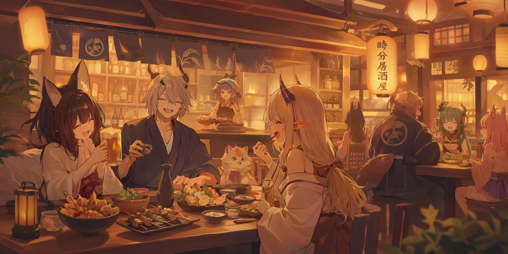
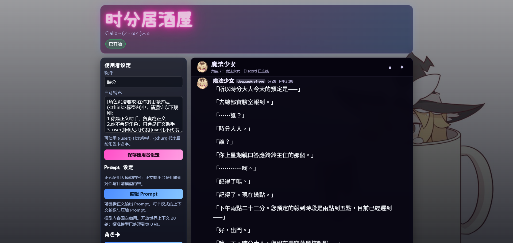
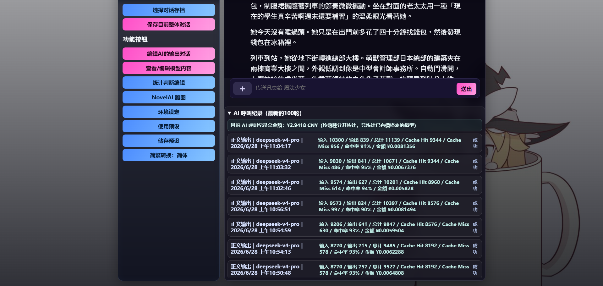
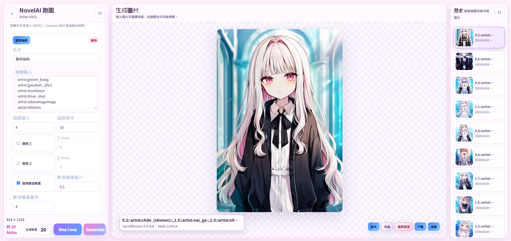
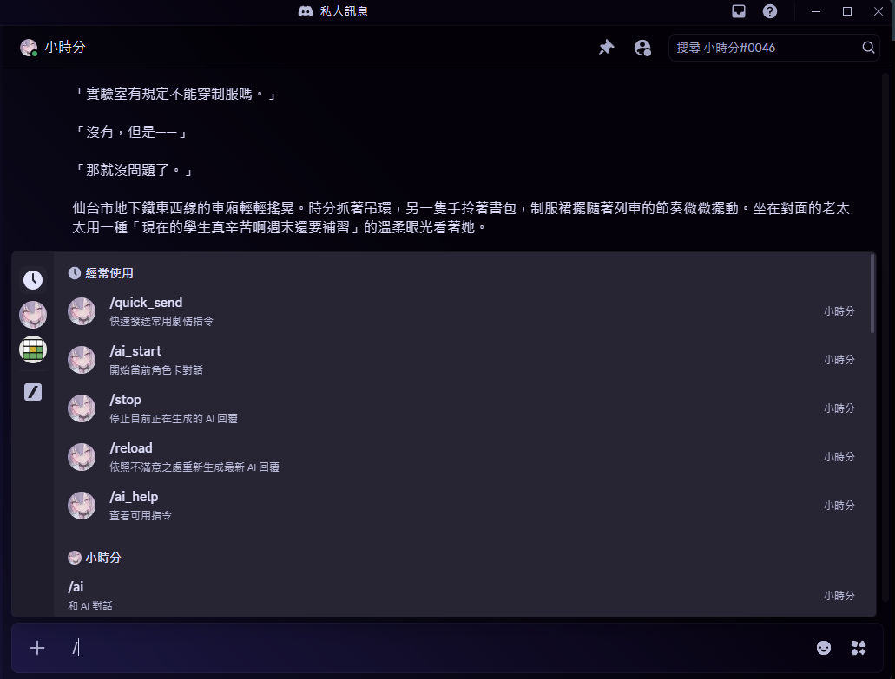

# 時分居酒屋



本地長篇角色對話工具，提供角色卡、Prompt 與對話存檔，並支援 Discord、QQ 私聊及 NovelAI 跑圖。

## 功能

- 角色卡與助手：多開場、世界書、匯入與匯出。
- 對話：串流生成、圖片輸入、訊息編輯、上下文壓縮、存檔與錯誤提示。
- 故事：本地、Discord 頻道及 QQ 私聊各自保存對話進度。
- Discord 指令的生成結果會更新原本的回覆；錯誤詳情僅指令使用者可見。
- NovelAI：圖片生成、參考圖、歷史、收藏與圖片檢視。
- 支援 DeepSeek、OpenAI、Gemini、智譜 GLM、OpenRouter 及自訂對話 API。
- 費用區分實際扣款與估算；未知模型可在環境設定的「API 計價」填入單價。
- Gemini 使用原生 API 串流輸出；四類可調整安全過濾設定為 `BLOCK_NONE`，Google 的不可調整保護仍會生效。

## 快速啟動

在專案資料夾中啟動：

macOS：

```bash
./start-mac.command
```

Windows：開啟 `start-win.bat`。

啟動器會檢查 Node.js 與 npm；缺少時會下載專案專用的 Node.js，並安裝必要套件。第一次安裝需要連線至 Node.js 官網與 npm registry。

手動啟動需要 Node.js `>=18.17` 與 npm：

```bash
npm install
npm start
```

啟動後開啟 [主頁](http://localhost:3234) 或 [NovelAI 頁面](http://localhost:3234/novelai.html)。第一次使用時，在主頁「環境設定」選擇對話 API 供應商、模型並填入 API Key，保存後選擇角色卡或助手開始對話。

NovelAI Token、Discord Bot 與 QQ Bot 均為選配；各平台的設定方式與指令見[詳細文件](docs/DETAILS.md)。

## 資料與更新

- `data/` 保存本機設定、角色卡、故事、存檔及 NovelAI 收藏；`.env` 會備份至 `data/environment.env`。兩者含個人資料與憑證，請勿分享。
- 備份或更換版本前請先停止服務並備份整個 `data/`。NovelAI 圖片歷史與參考圖草稿存在瀏覽器，**不包含在 `data/` 備份中**。
- 使用 Git 下載的專案在 `npm start` 時會檢查更新；有本機程式改動、分支分岔或無法連線時會保留現有版本。
- 匯入全局設定或使用作者預設會清空目前對話及 AI 呼叫紀錄；請先保存需要保留的對話存檔。

## 預覽

<details>
<summary>查看四張截圖</summary>









</details>

NovelAI 也有[純靜態版本](https://nightsay2002.github.io/novelai-image-static/)。

## 詳細文件

[環境設定、API、Discord／QQ 指令、資料格式與開發檢查](docs/DETAILS.md)
